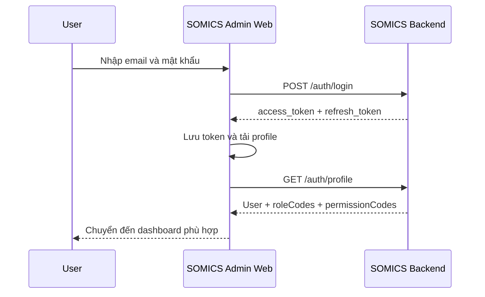

# SOMICS Admin Web authentication flow

SOMICS Admin Web xác thực qua SOMICS Backend REST API. Frontend lưu access/refresh
token trong `localStorage`; `src/lib/apiClient.ts` là nơi duy nhất quản lý token và
refresh request.

## Đăng nhập

`useMe` trong `src/features/auth/hooks/useAuth.ts` khôi phục trạng thái đăng nhập khi
ứng dụng khởi động. Sau login, `useLogin` lưu profile vào React Query cache với
key `auth.me`. Loader, permission guard và UI đọc chung cache này khi chuyển trang;
chỉ tải lại profile khi cache trống hoặc bị invalidate sau khi cập nhật user/role.
Token lifecycle vẫn thuộc `apiClient`.

## Request được bảo vệ

1. Request interceptor lấy access token và thêm header
   `Authorization: Bearer <token>`.
2. Backend xác thực JWT và permission.
3. Nếu response là HTTP 401, response interceptor gửi một request
   `POST /auth/refresh` bằng refresh token.
4. Các request 401 đồng thời dùng chung một `refreshRequest`, tránh refresh nhiều lần.
5. Nếu refresh thành công, request ban đầu được retry với access token mới.
6. Nếu refresh thất bại, frontend xóa token và phát sự kiện `logout`.

## Các luồng public

- Đăng ký: `POST /auth/register`
- Xác thực email: `POST /auth/verify-email`
- Gửi lại email xác thực: endpoint tương ứng trong `authService`
- Quên mật khẩu: `POST /auth/forgot-password`
- Đặt lại mật khẩu: `POST /auth/reset-password`

Route và page auth nằm dưới `src/routes/(auth)` và `src/features/auth/pages`.

## Quy tắc

- Không gọi Axios trực tiếp từ page auth; dùng `authService`.
- Không đọc/ghi token rải rác trong feature code.
- Không log token hoặc đưa token vào URL.
- Không coi việc ẩn UI là kiểm soát bảo mật; backend luôn phải xác thực request.
- Error hiển thị cho người dùng được map qua error code/i18n trước khi fallback sang
  server message.
