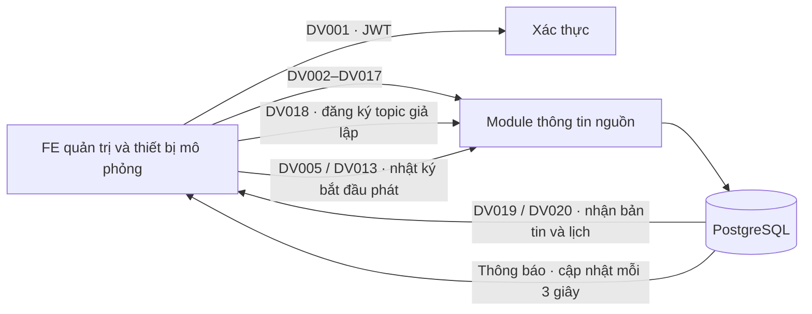

# Thông tin nguồn · DV001–DV020

Có 20 dịch vụ bao gồm DV001 xác thực. Mỗi dịch vụ có endpoint POST, hàm xử lý backend và hàm dịch vụ FE tương ứng. Module hỗ trợ giả lập hệ thống nguồn và thiết bị, lưu dữ liệu thật vào PostgreSQL; chưa kết nối broker MQTT hoặc nhà cung cấp thiết bị vật lý.

## Luồng kết nối



Cụm loa: DV008 → DV018 → DV002 → DV019 → DV006 → DV005. Bảng điện tử: DV016 → DV018 → DV010 → DV020 → DV014 → DV013. Hủy: DV004 → DV007 hoặc DV012 → DV015. Khẩn cấp: DV003 / DV011, đồng bộ lại bằng DV019 / DV020. Các nút và trình gửi request trong FE gọi đúng endpoint qua HTTP.

## Danh mục API

Base URL mặc định: `http://localhost:3000/api/v1`. Các đường dẫn bên dưới đều được ghép sau base URL. Những URL không được phụ lục quy định cụ thể sử dụng đường dẫn SOMICS trong bảng. DV011 giữ đuôi `/thongtinnguon/liveDigitalsignage`; DV020 giữ `/device/digital/getplaylist`.

| Mã | Dịch vụ | POST path | Nguồn quy định đường dẫn |
| --- | --- | --- | --- |
| DV001 | Đăng nhập hệ thống | `/oauth/token` | Phụ lục 4 |
| DV002 | Tạo / cập nhật bản tin phát thanh kèm lịch phát | `/thongtinnguon/ipradio/playlist` | Nhà cung cấp quy định |
| DV003 | Phát bản tin phát thanh khẩn cấp | `/thongtinnguon/liveIpradio` | Nhà cung cấp quy định |
| DV004 | Hủy lịch phát thanh | `/thongtinnguon/ipradio/delete/playlist` | Nhà cung cấp quy định |
| DV005 | Nhật ký phát bản tin phát thanh | `/device/ipradio/log` | Phụ lục 4 |
| DV006 | Nhật ký tạo / cập nhật lịch phát thanh | `/device/ipradio/playlist` | Phụ lục 4 |
| DV007 | Nhật ký hủy lịch phát thanh | `/device/ipradio/delete/playlist` | Phụ lục 4 |
| DV008 | Trạng thái cụm thu phát thanh | `/device/ipradio/status/add` | Phụ lục 4 |
| DV009 | Thiết lập điều khiển cụm thu phát thanh | `/thongtinnguon/ipradio/control` | Nhà cung cấp quy định |
| DV010 | Tạo / cập nhật bản tin điện tử kèm lịch phát | `/thongtinnguon/digitalsignage/playlist` | Nhà cung cấp quy định |
| DV011 | Phát bản tin điện tử khẩn cấp | `/thongtinnguon/liveDigitalsignage` | Phụ lục 4 |
| DV012 | Hủy lịch phát bảng điện tử | `/thongtinnguon/digitalsignage/delete/playlist` | Nhà cung cấp quy định |
| DV013 | Nhật ký phát bản tin điện tử | `/device/digitalsignage/log` | Phụ lục 4 |
| DV014 | Nhật ký tạo / cập nhật lịch bảng điện tử | `/device/digitalsignage/playlist` | Phụ lục 4 |
| DV015 | Nhật ký hủy lịch bảng điện tử | `/device/digitalsignage/delete/playlist` | Phụ lục 4 |
| DV016 | Trạng thái bảng điện tử công cộng | `/device/digitalsignage/status/add` | Phụ lục 4 |
| DV017 | Thiết lập điều khiển bảng điện tử | `/thongtinnguon/digitalsignage/control` | Nhà cung cấp quy định |
| DV018 | Đăng ký kết nối MQTT giả lập | `/mqtt/dangkythietbi` | Phụ lục 4 |
| DV019 | Đồng bộ bản tin phát thanh và lịch phát | `/device/ipradio/getplaylist` | Phụ lục 4 |
| DV020 | Đồng bộ bản tin điện tử và lịch phát | `/device/digital/getplaylist` | Phụ lục 4 |

Swagger: `/api/v1/docs`. Request mẫu đủ 20 dịch vụ: `src/modules/information-source/data/appendix-examples.json` (bản tiếng Anh; bản đối chiếu gốc trong appendix-examples.vi.json), và `GET /api/v1/integration/services` (ID đồng nhất, thời gian cập nhật cho demo). Không nhúng mật khẩu trong request mẫu DV001. Tên trường và bảng đối chiếu: [information-source-fields.md](information-source-fields.md). Mẫu response đủ 20 dịch vụ trong `src/modules/information-source/data/appendix-responses.json`; các phần Object/Array không được phụ lục định nghĩa cụ thể giữ là object/mảng mở.

## Xác thực và phân quyền

DV001 nhận `{ "Username": "root@gmail.com", "Password": "mật khẩu tài khoản hiện có" }`. Username hỗ trợ tên đăng nhập, email hoặc số điện thoại. `Content` chứa access_token, refresh_token và expires_at. FE đăng nhập qua DV001, dùng lại refresh/profile/logout của hệ thống hiện có. Các API DV002–DV020 yêu cầu `Authorization: Bearer <access_token>` và quyền `integration.gateway.create`; đọc dữ liệu quản trị cần `integration.gateway.view`. Migration cấp các quyền view/create/update/delete cho CRUD; cấp các quyền này cho SUPER_ADMIN, ADMIN và SYSTEM_STAFF. Vai trò tùy chỉnh cấp qua màn hình phân quyền.

Không gian tích hợp được giới hạn theo ID tài khoản xác thực, không lấy quyền sở hữu từ SourceID của payload. Thiết bị/lịch/bản tin/thông báo của một tài khoản không xuất hiện dưới tài khoản khác. Đây là không gian mô phỏng theo tài khoản; triển khai nhiều tỉnh dùng chung cần bổ sung cấu hình đối tác và ánh xạ tenant trước khi kết nối thật.

## Lưu trữ và trạng thái

Schema `information_source` gồm devices, bulletins, playlists, deliveries, messages, notifications và commands. Mỗi lần cập nhật lịch tạo revision mới; các gói tin cũ giữ nguyên trong messages để đối chiếu payload của từng lần gửi. Ghi dữ liệu và thông báo trong cùng transaction.

- Tạo lịch: deliveries ở queued; đồng bộ hoặc xác nhận lịch chuyển received.
- Nhật ký DV005 / DV013 ghi nhận bắt đầu phát, chuyển playing; không đánh dấu hoàn tất phát.
- Hủy lịch chỉ tác động những thiết bị/địa bàn được chỉ định; trạng thái cancel_requested, đợi DV007 / DV015 mới thành cancelled. Các thiết bị còn lại vẫn nhận lịch.
- Lệnh DV009 / DV017 được lưu pending. Phụ lục không mô tả ý nghĩa CommandCode và xác nhận lệnh; không suy diễn lệnh đã được thực thi.
- DV018 trả topic theo ID thiết bị và địa bàn đã lưu. Các topic này được đăng ký giả lập; không mở socket đến broker.
- DV019 / DV020 chỉ trả lịch còn hiệu lực của đúng thiết bị, ưu tiên khẩn cấp. Không có lịch trả Content=null. Nếu có nhiều lịch, Content trả đúng một lịch ưu tiên khẩn cấp rồi cập nhật gần nhất, theo cấu trúc phụ lục. Chỉ lịch trả về mới được xác nhận received. Lịch bị yêu cầu hủy không được đồng bộ lại.
- API quản trị hiển thị 200 bản ghi gần nhất mỗi loại cùng tổng số bản ghi. Thông báo được cập nhật mỗi 3 giây và lưu trạng thái đã đọc trong database.

Các gói tin thành công giữ đúng envelope `SendStatus, Description, Content, Errors`, SendStatus=0. Riêng DV018 có đúng 3 trường `Content, SendStatus, Description`, theo phụ lục. Lỗi giữ envelope tương ứng, SendStatus=1 và HTTP 400/401/403/404/409/500 tương ứng. API quản trị tiếp tục dùng envelope success/result của ứng dụng.

Có thể gửi header `Idempotency-Key` (1–128 ký tự) để retry một thao tác mà không lặp dữ liệu. Cùng key, khác payload hoặc dịch vụ trả 409. Các nhật ký và trạng thái thiết bị tự khử trùng theo mã dịch vụ + payload chuẩn hóa. Trạng thái cũ hơn không ghi đè trạng thái hiện hành. Nhật ký chỉ thay đổi xác nhận của đúng thiết bị và revision hiện hành.

## Migration và seed

Các migration: `1791500000000-CreateInformationSource.ts` tạo schema; `1791530000000-EnglishInformationSourcePackets.ts` đổi tên trường JSON đã lưu và cập nhật hash retry; `1791540000000-InformationSourceCrud.ts` tạo bảng cấu hình, cấp quyền update/delete. Chạy migration tiếng Anh trước khi dùng FE/API mới. Chạy build và migration với biến DB/JWT/SEED_ROOT_PASSWORD đang sử dụng:

```sh
pnpm build
pnpm migration:run
```

Seed dữ liệu tách khỏi migration tự động; chỉ nạp khi chủ động chạy lệnh sau. Tài khoản nhận seed phải tồn tại, mặc định root@gmail.com. Seed không thay đổi mật khẩu hay tạo tài khoản.

```sh
SEED_INFORMATION_SOURCE_DEMO=true pnpm seed:information-source
# Có thể chọn tài khoản khác đã được cấp quyền tích hợp:
SEED_INFORMATION_SOURCE_DEMO=true SEED_INFORMATION_SOURCE_OWNER_EMAIL=operator@example.com pnpm seed:information-source
```

Fixture: `src/seeds/data/information-source-demo.json`, data migration: `src/seeds/information-source-demo.seed.ts`. Có 20 cấu hình mẫu (mỗi DV001–DV020 một cấu hình), 8 thiết bị (4 loa + 4 bảng điện tử), 20 bản tin, 8 lịch, 8 trạng thái giao lịch, 19 gói tin DV002–DV020, 19 thông báo và 2 lệnh pending. Mẫu request DV001–DV020 cũng có trong fixture. Không seed token hay nhật ký đăng nhập. Các hàng mẫu có seed_tag=appendix4-demo-v1. Thời gian được dịch về lúc nạp; chạy lại không nhân đôi hoặc ghi đè dữ liệu đang có.

Gỡ mẫu trong môi trường demo:

```sh
SEED_INFORMATION_SOURCE_DEMO=true pnpm seed:information-source -- --revert
```

Các bản ghi đã được cập nhật bởi lưu lượng thật hoặc còn được delivery thật tham chiếu được giữ lại.

## Frontend

Đặt `VITE_API_BASE_URL=http://localhost:3000/api/v1` trong FE, chạy `pnpm dev`, đăng nhập tài khoản đã cấp quyền, mở `/dashboard/integration`. Chọn Cụm loa hoặc Bảng điện tử rồi bấm Chạy giả lập. Kiểm tra Bản tin, Lịch phát, Thiết bị, Nhật ký API và chuông Thông báo. Trình gửi request cho phép sử dụng đủ 20 dịch vụ, kể cả auth, khẩn cấp, điều khiển và xác nhận hủy.

DV002, DV003, DV010 và DV011 mặc định bật **Tạo mã mới mỗi lần gửi**: mỗi lần bấm Gửi request tạo PlaylistID và mã bản tin mới, giữ nội dung/thiết bị đã chọn; JSON trên màn hình hiển thị đúng gói đã gửi. Tắt tùy chọn để cập nhật bằng mã hiện có. Kết quả tiếp nhận và nút mở Bản tin nằm phía trên trình nhập JSON. Bản tin ở cả màn hình đọc và CRUD được xếp theo thời điểm tiếp nhận/cập nhật gần nhất. Gửi lại nội dung giống nhau ghi nhận thời điểm tiếp nhận mới nhưng giữ revision nội dung; retry cùng Idempotency-Key trả kết quả cũ và không thay đổi dữ liệu.

Đã thay các màn hình demo bằng dữ liệu API; bỏ bài viết, danh mục bản tin và các form/edit cũ khỏi menu và route tree. Mã legacy được giữ nguyên trong dự án để khôi phục, được loại khỏi phần định tuyến và typecheck đang hoạt động qua tsr.config.json / vite.config.ts / tsconfig.json. Giữ địa bàn, media, người dùng, phân quyền, audit và cài đặt có liên quan vận hành.

## Kiểm chứng

`pnpm test -- --runInBand` kiểm tra backend. `pnpm test` trong FE kiểm tra frontend. Script `scripts/verify-information-source.cjs` kiểm tra đủ 20 API, username, phạm vi tài khoản, quyền chỉ xem, GPS/thời gian, retry, hủy một thiết bị, topic đăng ký, dữ liệu đồng bộ, thông báo và Swagger. Script này chỉ chạy trên backend thử nghiệm cổng 3019 và PostgreSQL tạm cổng 15439, với `INFORMATION_SOURCE_E2E=true DB_PORT=15439`; không trỏ script này vào database đang sử dụng.

## CRUD và giao diện quản lý

Mở `/dashboard/integration/configurations` để CRUD mẫu request/response cho đủ 20 dịch vụ. Có 20 ô chọn dịch vụ, bộ lọc, xem chi tiết, form tạo/sửa cấu hình, bật/tắt mẫu, xác nhận xóa và gửi thử. Mỗi mã DV có thể lưu nhiều mẫu. Đường dẫn và mã API nằm trong catalog hệ thống; cấu hình quản lý tên, mô tả, trạng thái và payload mẫu. Password để trống khi lưu; token và mật khẩu chỉ được nhập tại bước gửi thử.

Mở `/dashboard/integration/data` để CRUD thiết bị, bản tin, lịch phát, lệnh điều khiển và thông báo. Có form thông tin chính, chọn thiết bị/bản tin đã lưu và JSON đầy đủ bằng tiếng Anh. Các trang Bản tin/Lịch phát/Thiết bị/Thông báo/Nhật ký có nút vào phần quản lý tương ứng. CRUD tài khoản và phân quyền nằm trong các trang Người dùng/Vai trò hiện có.

| Thao tác | Cấu hình dịch vụ | Dữ liệu nghiệp vụ |
|---|---|---|
| Danh sách | GET `/integration/service-configurations` | GET `/integration/data/:resource` |
| Chi tiết | GET `/integration/service-configurations/:id` | GET `/integration/data/:resource/:id` |
| Thêm | POST `/integration/service-configurations` | POST `/integration/data/:resource` |
| Sửa | PATCH `/integration/service-configurations/:id` | PATCH `/integration/data/:resource/:id` |
| Xóa | DELETE `/integration/service-configurations/:id` | DELETE `/integration/data/:resource/:id` |

`resource`: devices, bulletins, playlists, commands, notifications. Các API quản trị này dùng envelope success/result. GET cần quyền view, POST create, PATCH update, DELETE delete của integration.gateway. Tất cả dữ liệu được giới hạn theo tài khoản đang đăng nhập.

Tạo/sửa cấu hình nhận `{serviceCode,name,description,enabled,requestPacket,responsePacket,revision?}`. Sửa phải gửi revision hiện tại; dữ liệu đã thay đổi trả 409. Payload mẫu được kiểm tra đúng contract của mã DV. Không cho lưu mật khẩu/token.

Tạo/sửa thiết bị, bản tin, lịch hoặc lệnh nhận `{channel,packet,revision?}`. Packet là cấu trúc tiếng Anh theo API tương ứng. Thiết bị dùng DV008/DV016; lịch dùng DV002/DV003/DV010/DV011; lệnh dùng DV009/DV017; bản tin dùng object trong Bulletins hoặc DailyBulletins. Thông báo nhận `{serviceCode,title,body,severity,read}`.

Khi sửa bản tin đang trong lịch còn hiệu lực, các lịch liên quan được tạo revision mới và đưa delivery về queued để thiết bị đồng bộ nội dung đã sửa. Mã ngoài và kênh của thiết bị/bản tin/lịch được giữ ổn định khi sửa. Không xóa thiết bị còn được lịch/lệnh dùng hoặc bản tin còn trong lịch; API trả 409 để xử lý liên quan trước. Xóa lịch xóa các delivery của lịch; các gói tin và thông báo đã nhận vẫn giữ để đối chiếu. Lệnh CRUD lưu pending; trạng thái thực thi cần xác nhận từ thiết bị.

Kiểm chứng bổ sung: `scripts/verify-information-source-english-migration.cjs` kiểm tra chuyển đổi dữ liệu và retry; `scripts/verify-information-source-crud.cjs` chạy CRUD cho từng DV và 5 nhóm dữ liệu, cả loa/bảng điện tử, revision, quyền và đồng bộ bản tin đã sửa. Các script chỉ chạy trong database thử nghiệm tạm được chỉ định.
