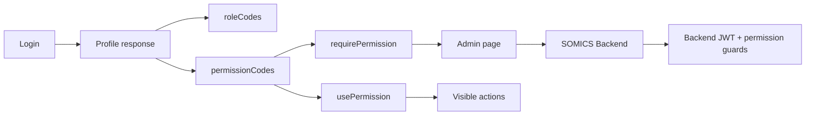

# SOMICS Admin Web permission flow

SOMICS Backend là nguồn sự thật của role và permission. Frontend dùng permission để
bảo vệ navigation và action, nhưng backend vẫn thực thi authorization cho mọi request.

## Permission format

Permission code có dạng:

```text
module.resource.action
```

Ví dụ:

- `dashboard.overview.view`
- `post.post.view`
- `post.post.create`
- `media.library.update`
- `user.role.view`
- `system.audit_log.view`

Catalog liên quan:

- `shared/module-catalog.ts`: module và resource.
- `shared/permission-codes.ts`: permission constants dùng trong frontend.
- `shared/permissions.ts`: action/type hỗ trợ.
- `shared/roles.ts`: role code và metadata hiển thị.

Khi backend thêm permission, cập nhật các catalog frontend liên quan trong cùng thay
đổi tích hợp.

## Route guard

Dashboard route kiểm tra permission trong `beforeLoad`:

```tsx
export const Route = createFileRoute('/_dashboard/dashboard/posts/')({
  beforeLoad: () => requirePermission('post.post.view'),
  component: PostsPage,
})
```

Nếu user chưa đăng nhập, auth flow điều hướng về trang login. Nếu đã đăng nhập nhưng
không có quyền, điều hướng đến trang forbidden.

## Component action

Action trong UI nên kiểm tra permission tương ứng:

```tsx
const canCreate = usePermission('post.post.create')

return canCreate ? <CreatePostButton /> : null
```

Không dùng role name như `ADMIN` để thay thế permission cho action thông thường.
`SUPER_ADMIN` được backend/profile đánh dấu bypass; frontend sử dụng trạng thái auth
hiện có thay vì tự suy diễn.

## Luồng dữ liệu



## Quy tắc

- Route guard và action visibility dùng cùng permission code với backend.
- Không hardcode permission string ở nhiều nơi nếu đã có constant tương ứng.
- Ẩn button không thay thế backend authorization.
- Service không tự thay đổi permission hoặc role của user trong client state nếu chưa
  nhận response thành công từ backend.
- Khi mutation thay đổi role/permission, invalidate profile và dữ liệu quản trị liên
  quan.
- UI forbidden, empty state và error message phải có bản dịch Việt/Anh.
